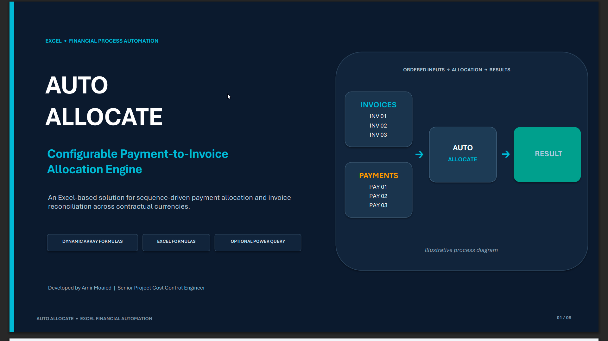
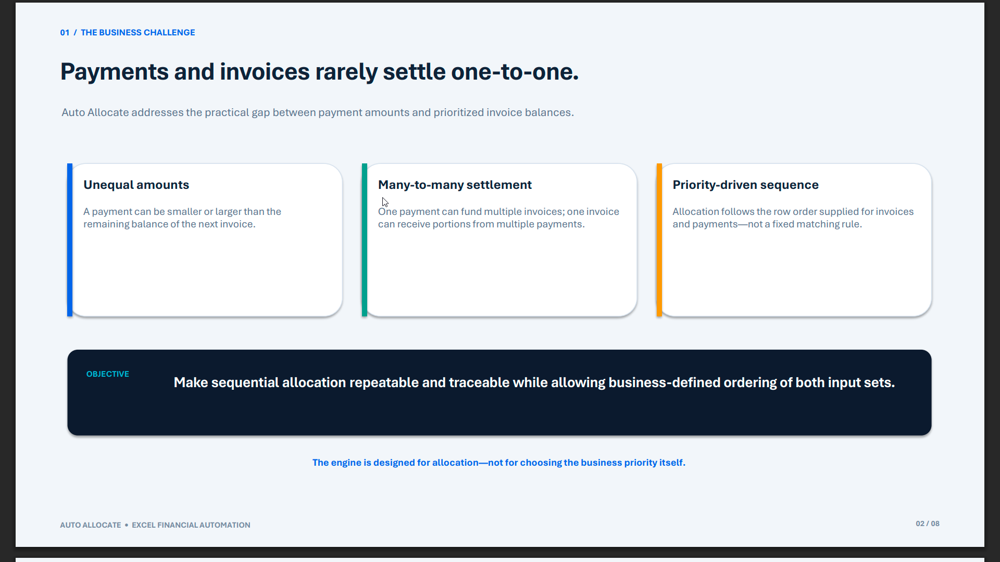
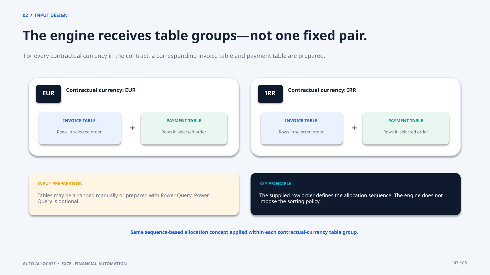
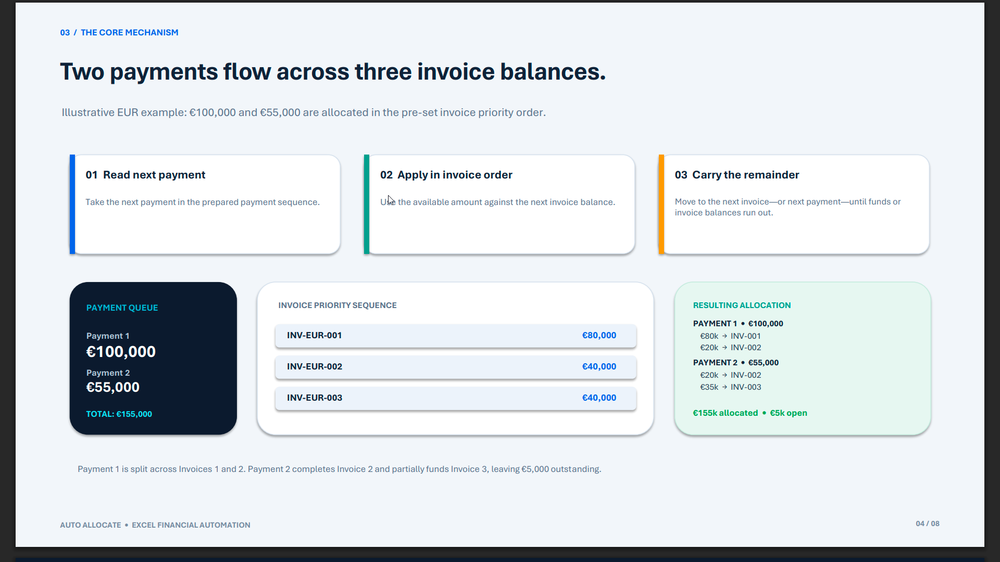
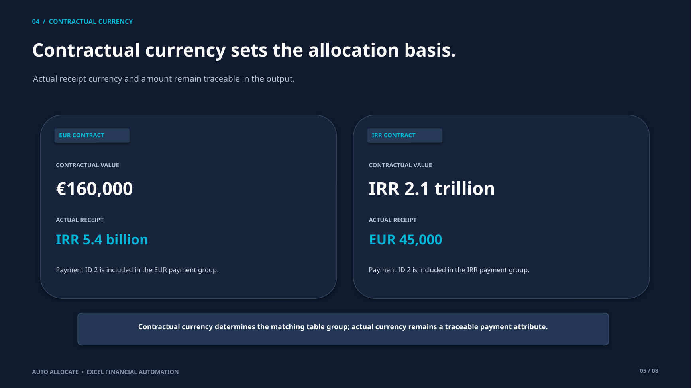
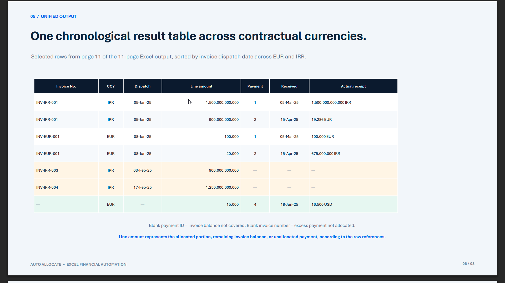
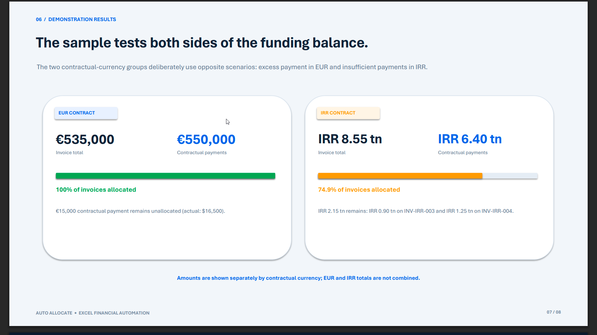
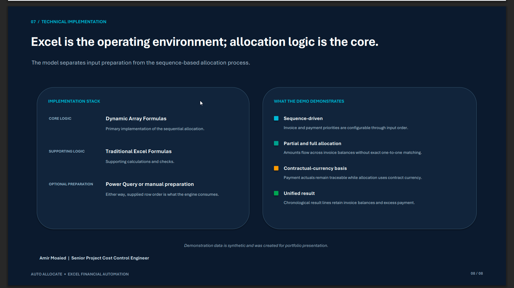

# Auto Allocate – Automated Payment-to-Invoice Allocation Engine

  
  
  
  
  

**Auto Allocate** is an Excel-based **automated payment-to-invoice allocation and reconciliation engine**. It applies payments to prioritized invoice balances in a configurable sequence, handles partial and full settlements, and keeps actual receipt details traceable while allocating on the relevant contractual-currency basis.

The workbook is designed for finance, project cost control, and accounts receivable workflows where payments and invoices do not settle in simple one-to-one matches.

> **Core principle:** Auto Allocate follows the invoice and payment row order supplied to the engine. It performs the allocation; it does not decide the business priority or impose a fixed FIFO rule.

## Quick Links

- [Download the Excel allocation engine](files/Auto_Allocate_Demo.xlsx)
- [Read the project case study (PDF)](docs/Auto_Allocate_Case_Study.pdf)
- [Connect with Amir Moaied on LinkedIn](https://www.linkedin.com/in/moaied-amir/)

## Project Overview

In project finance and accounts receivable operations, received payments often differ from invoice amounts. One payment may cover several invoices, while one invoice may be settled through multiple payments over time. The actual receipt currency may also differ from the currency specified in the contract.

Auto Allocate addresses these situations with a formula-driven Excel workflow that applies payment amounts to invoice balances in sequence and produces a consolidated allocation result.

## Business Challenge

Manual payment allocation can require repeated comparisons across payment records, invoice balances, payment dates, currencies, and contract terms. The process becomes more demanding when:

- Payment amounts do not exactly match invoice balances.
- One payment must be split across multiple invoices.
- One invoice receives amounts from multiple payments.
- Some invoices remain partially or fully unpaid.
- A payment exceeds the remaining invoice balances.
- Actual receipt currency differs from contractual currency.

Auto Allocate is designed to make this sequential allocation process more consistent, repeatable, and traceable.

## Key Features

| Capability | What it does |
|---|---|
| Sequential payment allocation | Applies payment funds to invoice balances in the supplied order. |
| Partial and full settlement | Handles both partial allocations and completed invoice settlements. |
| Many-to-many allocation | Allows one payment to cover multiple invoices and one invoice to receive multiple payments. |
| Configurable processing priority | Uses the row order supplied for invoice and payment inputs. |
| Contractual-currency allocation | Processes each contractual-currency group on a consistent currency basis. |
| Actual receipt traceability | Retains actual payment currency and amount alongside the contractual equivalent used for allocation. |
| Outstanding invoice visibility | Keeps unpaid and partially paid invoice balances identifiable. |
| Excess payment visibility | Identifies payment value that remains after the available invoice balances are covered. |
| Consolidated result | Brings allocation lines into a unified chronological output across the demonstrated contractual currencies. |

## Input Structure and Processing Order

The engine receives invoice and payment input tables grouped by contractual currency. The demonstration workbook includes EUR and IRR groups.

For each contractual-currency group:

1. Prepare the relevant invoice input table.
2. Prepare the corresponding payment input table.
3. Arrange invoice rows in the business-defined priority order.
4. Arrange payment rows in the business-defined processing order.
5. Ensure the payment amount supplied for allocation is expressed as the contractual equivalent for that group.

Input tables may be prepared manually or with **Power Query**. Power Query is optional; it is not a prerequisite for the allocation engine.

## How the Sequential Allocation Engine Works

The core allocation process is sequence-driven:

1. Read the next payment in the supplied payment order.
2. Apply the available payment amount to the next invoice balance in the supplied invoice order.
3. Allocate the lower of the available payment amount and the remaining invoice balance.
4. Carry forward any remaining payment amount or invoice balance.
5. Continue through the ordered invoice and payment inputs until the available funds or invoice balances are exhausted.

This supports partial settlement and many-to-many allocation without requiring exact one-to-one payment and invoice amounts.

**The engine does not determine the sorting policy.** The user or upstream process defines invoice and payment priority by arranging the input rows before calculation. The engine processes that supplied order.

## Multi-Currency and Contractual-Currency Logic

Auto Allocate distinguishes between:

- **Actual payment currency and amount:** what was actually received.
- **Contractual currency and equivalent amount:** the basis on which the payment is allocated against invoices under the relevant contract.

Each contractual currency is processed in its corresponding invoice and payment table group. If a receipt is made in a currency different from the contractual currency, the corresponding contractual equivalent must be provided in the payment input. The actual currency and amount remain traceable in the output.

**Foreign exchange conversion is not performed by the core allocation engine.** Contractual equivalents are prepared before allocation. EUR and IRR amounts are maintained separately and are not added together as though they were the same currency.

## Consolidated Allocation Output

The workbook produces a consolidated chronological allocation result across the demonstrated contractual-currency groups. The result is designed to make invoice settlement and excess payment outcomes visible in one place.

The output distinguishes between:

- Allocated portions of invoice balances.
- Remaining invoice balances that have not been covered.
- Excess payment amounts that have not been allocated to an invoice.
- Payment references and actual receipt details for traceability.

An invoice may appear on multiple output lines when it is funded by more than one payment. In the result layout, a blank payment reference indicates an invoice balance not covered by a payment; a blank invoice reference indicates excess payment not allocated to an invoice.

## Demonstration Results

The synthetic demonstration illustrates two different funding scenarios. Amounts are shown separately by contractual currency.

### EUR Contract

| Indicator | Demonstration result |
|---|---:|
| Total invoice amount | €535,000 |
| Total contractual payments | €550,000 |
| Invoice allocation coverage | 100% |
| Excess contractual payment | €15,000 |

All demonstrated EUR invoice balances are covered. After allocation, €15,000 remains as an excess contractual payment (the actual receipt equivalent shown in the case study is USD 16,500).

### IRR Contract

| Indicator | Demonstration result |
|---|---:|
| Total invoice amount | IRR 8.55 trillion |
| Total contractual payments | IRR 6.40 trillion |
| Invoice allocation coverage | 74.9% |
| Outstanding invoice balance | IRR 2.15 trillion |

The demonstrated IRR payments do not cover all invoice balances. IRR 0.90 trillion remains outstanding on the third invoice and IRR 1.25 trillion on the fourth invoice.

The EUR and IRR totals are not combined. These figures describe the synthetic portfolio demonstration, not actual company or project transactions.

## Excel Technical Implementation

Auto Allocate is implemented in Microsoft Excel with the allocation logic at its center.

| Component | Implementation |
|---|---|
| Core allocation logic | Dynamic Array Formulas |
| Supporting calculations and checks | Traditional Excel formulas |
| Input preparation | Manual preparation or optional Power Query |
| Allocation basis | Contractual-currency equivalent supplied in the payment input |
| Final reporting | Consolidated chronological allocation result |

The workbook depends on Excel formula functionality, including Dynamic Array support. Use an Excel version that supports the formulas included in the workbook. Preserve the original table structure and formula areas when replacing or updating input data.

## How to Use the Workbook

1. Download and open [Auto_Allocate_Demo.xlsx](files/Auto_Allocate_Demo.xlsx).
2. Save a working copy before entering new data.
3. Update the invoice and payment inputs in the relevant contractual-currency groups.
4. Confirm that invoice and payment rows are arranged in the intended business priority order.
5. For receipts made in a different currency, provide the contractual equivalent required for allocation while retaining the actual receipt currency and amount.
6. Allow Excel to recalculate the workbook.
7. Review the consolidated allocation result, remaining invoice balances, and any excess payment amounts.

Do not overwrite formula cells or change the workbook's underlying table structure unless you are intentionally modifying and testing the model.

## Business Value

Auto Allocate demonstrates how Excel financial automation can support project cost control and accounts receivable reconciliation by:

- Reducing repetitive manual payment allocation.
- Applying a consistent, configurable allocation sequence.
- Making partial and full invoice settlements easier to review.
- Improving visibility of outstanding invoice balances and excess payments.
- Preserving traceability between actual receipts and contractual allocation values.
- Producing a consolidated result for financial review and follow-up.

## Scope and Limitations

- Allocation follows the supplied invoice and payment row order; the engine does not select business priorities automatically.
- Foreign exchange conversion is outside the core allocation engine. Contractual equivalents must be provided in the input data.
- The public demonstration illustrates EUR and IRR contractual-currency groups. Additional currencies require corresponding input groups and appropriate model setup.
- Excel compatibility depends on support for the Dynamic Array formulas used in the workbook.
- The included demonstration data is synthetic and prepared for portfolio presentation.

## Potential Future Enhancements

- Additional contractual-currency groups.
- More automated input preparation and validation.
- Expanded reconciliation and exception checks.
- Additional reporting views for financial control and management review.
- Integration with Power BI for allocation monitoring and financial dashboards.

## Project Files

| File | Description |
|---|---|
| [Auto_Allocate_Demo.xlsx](files/Auto_Allocate_Demo.xlsx) | Excel payment-to-invoice allocation engine. |
| [Auto_Allocate_Case_Study.pdf](docs/Auto_Allocate_Case_Study.pdf) | Visual case study explaining the business challenge, allocation approach, currency logic, output, and demonstration results. |
| [Project image gallery](docs/images/) | Eight project walkthrough images used in this README. |

## About the Developer

**Amir Moaied**  
Senior Project Cost Control Engineer  
Focus areas: EPC project cost control, financial process automation, Excel-based allocation, Power BI reporting, and financial reconciliation.

[Connect with Amir Moaied on LinkedIn](https://www.linkedin.com/in/moaied-amir/)

---

*Auto Allocate is a portfolio project demonstrating a configurable, formula-driven approach to automated payment-to-invoice allocation and financial reconciliation in Microsoft Excel. All demonstration data is synthetic.*
